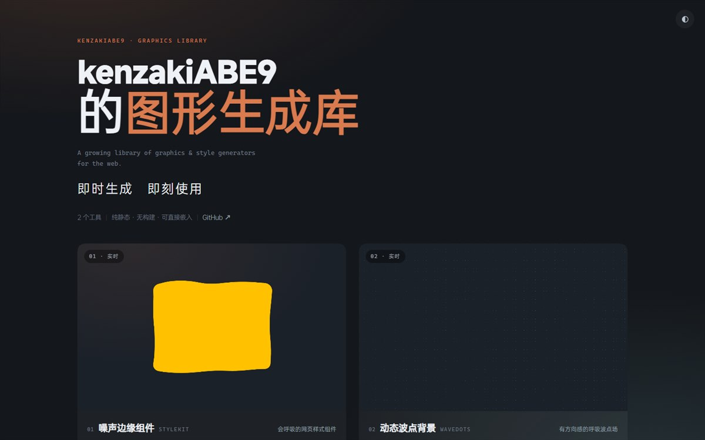
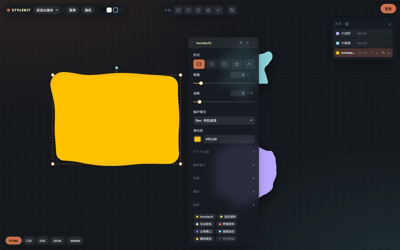

# kenzakiABE9 的图形生成库

**即时生成　即刻使用**

一组能直接在网页里跑的图形与样式生成工具。每个工具都是独立的静态页面 —— 零依赖、无需构建，打开即用，也能单独嵌进任何网页。

### [→ 打开线上站点](https://illustrious-entremet-5db35f.netlify.app/)



---

## 工具

### 01　噪声边缘组件 · StyleKit

纯色块，边缘由三维噪声实时生成，连续可调，像有生命的液体。

- 五种底形：矩形 / 椭圆 / 多边形 / 星形 / SVG 路径
- 直接在图形上拖把手缩放、旋转；参数实时联动
- 导出 HTML、CSS、SVG、JSON，或把动画录成 WebM

**[打开 →](https://illustrious-entremet-5db35f.netlify.app/apps/stylekit/)**



### 02　动态波点背景 · WaveDots

规则点阵上跑一道有方向感的行波，波峰处的点更大更亮，整片会缓慢呼吸。

- 可调方向、波长、波速、起伏强度、点距、点径、随机与呼吸
- 鼠标透镜 + 点击涟漪
- 导出 PNG，或导出一段可独立部署的 WebGL 代码

**[打开 →](https://illustrious-entremet-5db35f.netlify.app/apps/wavedot/)**


---

## 在本地跑起来

需要先克隆仓库，再用任意静态服务器打开（页面要 `fetch` 清单和预览 iframe，必须走 http，不能直接双击 HTML）。

```bash
git clone https://github.com/ABE9-mix/dynamicstyle-toolkit.git
cd dynamicstyle-toolkit
python3 -m http.server 8791
# 浏览器打开 http://127.0.0.1:8791/
```

没有依赖，也**没有构建步骤**。

## 用在你的页面里

- **噪声边缘块**：把 [`apps/stylekit/dist/wavy-edge.js`](apps/stylekit/dist/wavy-edge.js)（约 39 KB）拷到你的站点，然后放一个标签就有

  ```html
  <script src="wavy-edge.js"></script>
  <wavy-edge w="520" h="340" fill="#c8f751" amp="9" waves="5"></wavy-edge>
  ```

  全部参数与用法见 [apps/stylekit/README.md](apps/stylekit/README.md)。

- **动态波点**：在页面里点「导出 WebGL 代码」，会下载一个独立的 HTML，直接拿去用。

## 目录结构

```
.
├─ index.html           总目录页
├─ apps.json            工具清单
├─ assets/              总目录样式与图标
└─ apps/
   ├─ stylekit/         噪声边缘组件
   └─ wavedot/          动态波点背景
```

## 技术

- 纯静态：原生 JavaScript + Canvas / WebGL，无框架、无打包器
- 每个工具自包含一个目录，`apps.json` 是唯一的清单
- 视觉与排版规范见 [DESIGN.md](DESIGN.md)

## 关于

个人项目，用来快速产出「拿到就能用」的网页图形与样式组件。
仓库：[ABE9-mix/dynamicstyle-toolkit](https://github.com/ABE9-mix/dynamicstyle-toolkit)
